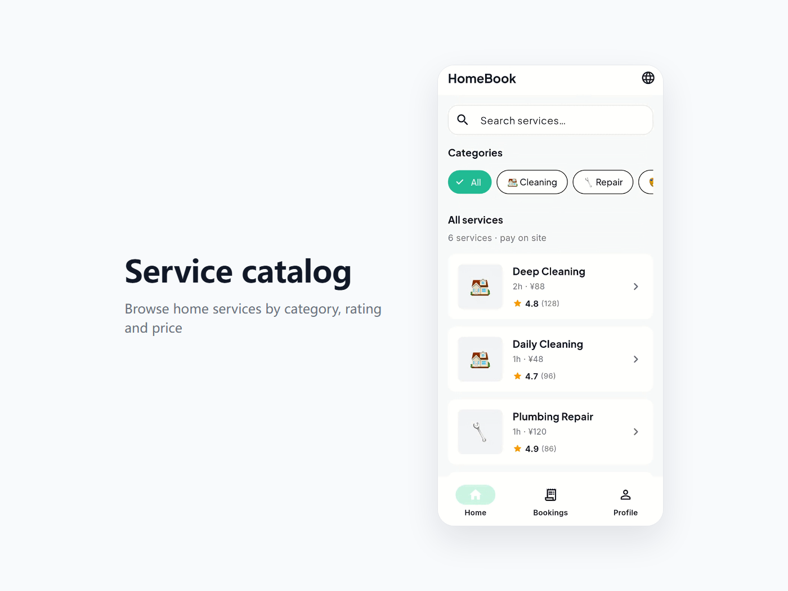
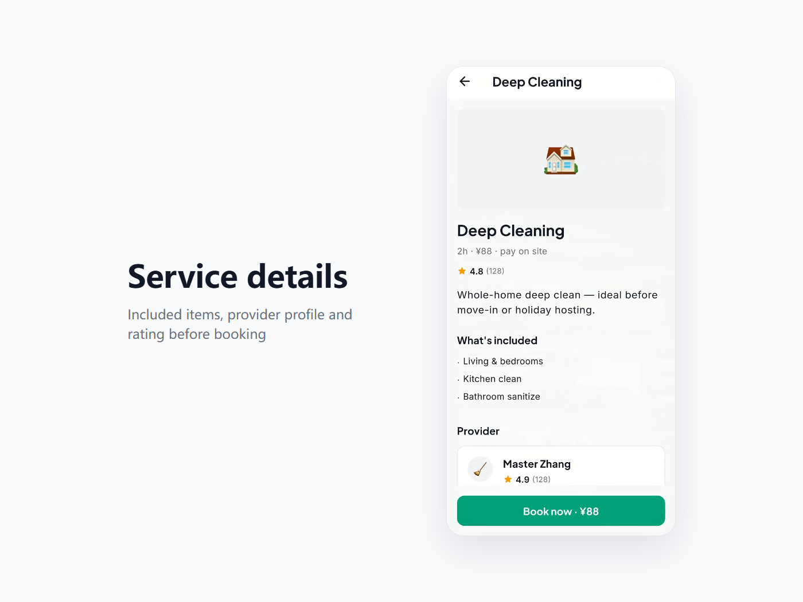
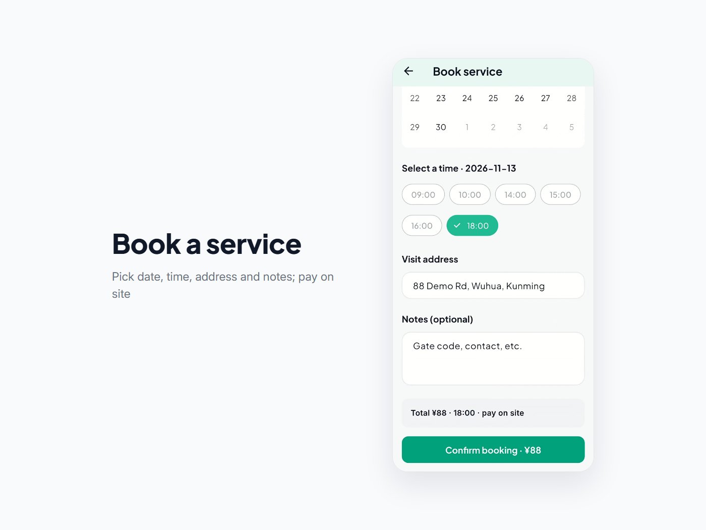
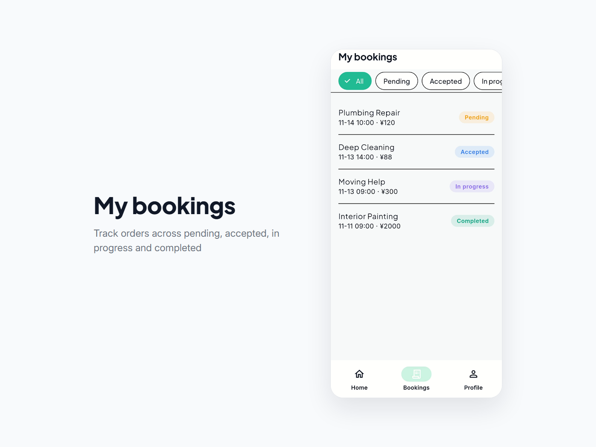
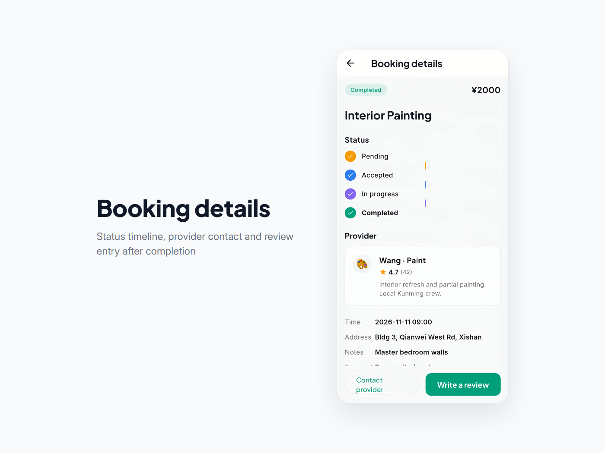
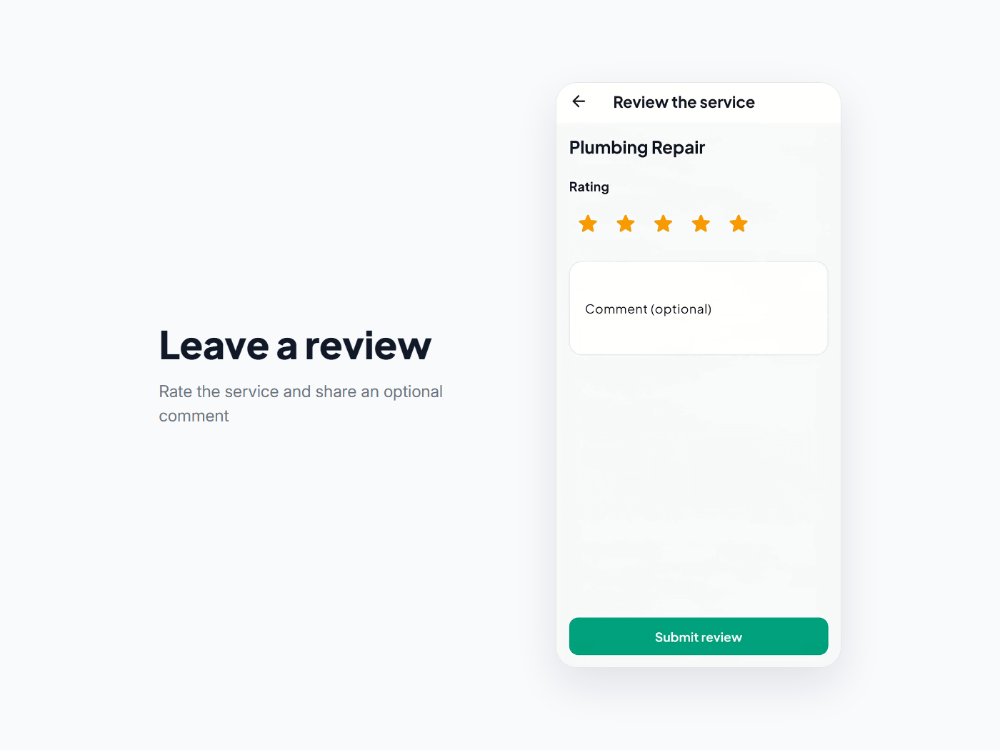
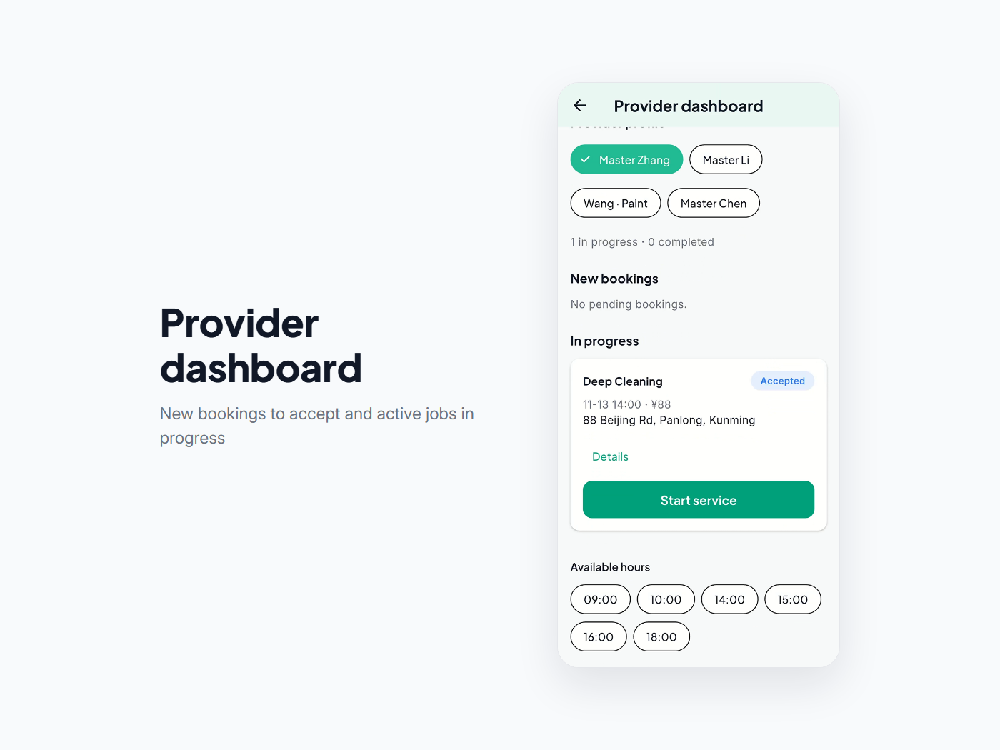
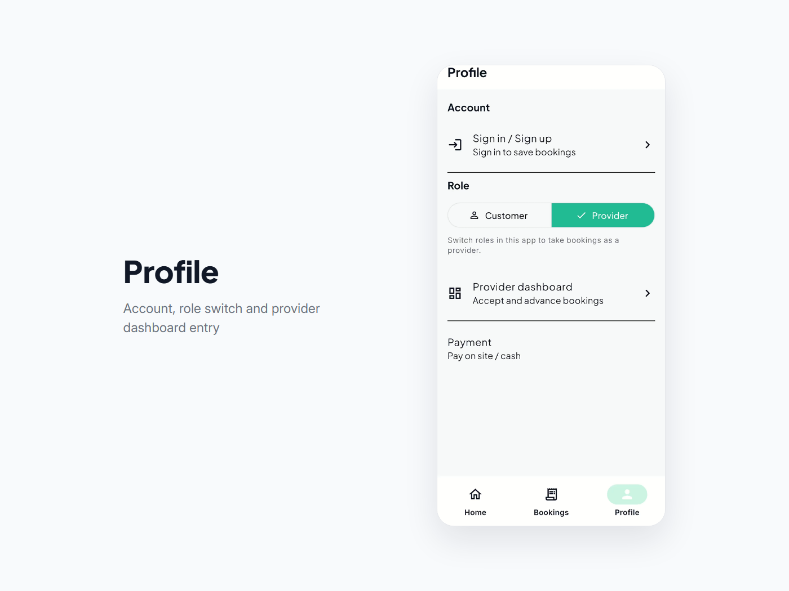
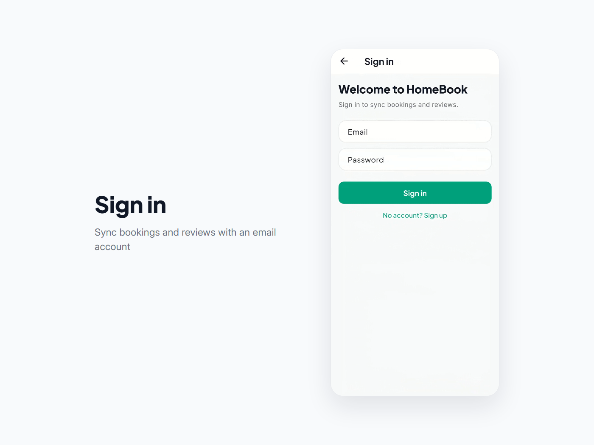

# HomeBook

[](https://flutter.dev)
[](https://riverpod.dev)
[](https://supabase.com)
[](LICENSE)
[](pubspec.yaml)

A **from-scratch** Flutter home-services booking MVP.

Browse services → pick a date and slot → book → provider accepts → complete on site.  
**Mock** mode works offline. **Supabase** mode adds Auth plus bookings/reviews sync.

[Demo video (MP4)](docs/screenshots/demo_video.mp4)

## Screenshots

| Services | Detail | Book |
| :---: | :---: | :---: |
|  |  |  |

| Bookings | Booking detail | Review |
| :---: | :---: | :---: |
|  |  |  |

| Provider | Profile | Sign in |
| :---: | :---: | :---: |
|  |  |  |

Capture notes: [`docs/screenshots/README.md`](docs/screenshots/README.md).  
Architecture diagram: [`docs/screenshots/architecture.png`](docs/screenshots/architecture.png).

## Features

- Four service categories (cleaning / repair / renovation / moving) with search and chips  
- Service details, calendar booking, visit address, and pay-on-site checkout  
- Booking list + detail with status timeline (`pending → accepted → in_progress → completed`, or `cancelled`)  
- Dual role in one app: customer and provider dashboard (accept / start / complete)  
- Reviews after a completed booking  
- Email/password auth UI (in-memory Fake Auth or Supabase Auth)  
- **en / zh** UI (follow system with English fallback, or lock language from the home AppBar)

## Architecture

```text
UI (features/*/presentation)
  → Riverpod Notifiers
    → Repository interfaces
      → Mock / Fake  or  Supabase implementations
```

Feature-first folders under `lib/features/{auth,services,bookings,reviews,providers,profile,settings}` plus shared `lib/app` and `lib/core`.

## Quick start (Mock)

```bash
flutter pub get
flutter run
```

```bash
flutter test
```

Default is Mock (no cloud credentials required).

## Supabase (optional)

1. Create **your own** Supabase project  
2. Run `supabase/migrations/20261110220000_homebook_core.sql` in the SQL Editor  
3. Copy `.vscode/supabase.example.json` → `.vscode/supabase.local.json` and fill your project URL + anon key  
4. Authentication → Providers → Email: turn **Confirm email** off for local demos  

```bash
flutter run --dart-define-from-file=.vscode/supabase.local.json
```

With credentials present, sign-in syncs bookings and reviews (best-effort pull + push). Bind `providers.user_id` to the matching `auth.users.id` if you want a provider identity on the cloud.

## Limitations (MVP honesty)

- Pay on site / cash only — no payment SDK  
- Fake Auth is in-memory (cleared when the process exits)  
- Provider available hours are a read-only sample, not an editable schedule  
- Contact provider is a snackbar placeholder (no in-app chat)  
- No push notifications  

## i18n

UI chrome is **English** and **Chinese**. Follow the system locale (English fallback), or lock **System / English / 中文** from the home AppBar.

Catalog seed (services / providers / demo bookings) is **English canonical**, aligned with the SQL migration seed. UI chrome remains en/zh via ARB.

## Version

`0.7.4+11`

## License

MIT — see [`LICENSE`](LICENSE).
